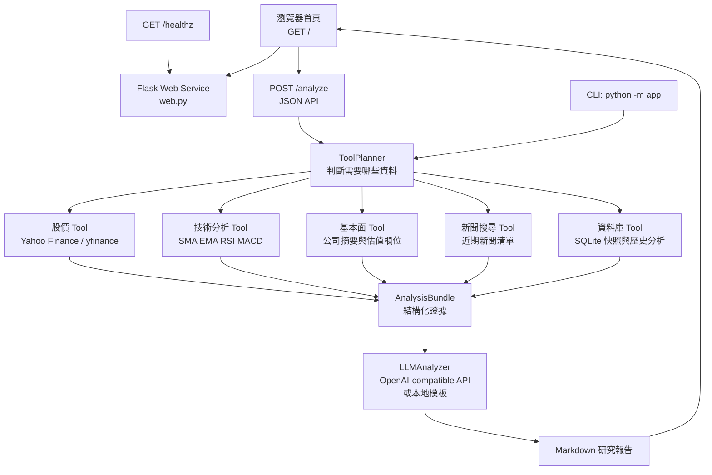

# 台股 AI Agent（Python）

這是一個可在本機執行的**唯讀台股研究 Agent**，把使用者問題先交給可檢查的工具路由，再把結構化資料交給 LLM 綜合成繁體中文 Markdown 報告。

## 系統架構



## 已實作功能

- 支援上市與上櫃代號：`2330` 會正規化為 `2330.TW`；`6488.TWO` 可直接使用。
- 以問題關鍵字路由工具：價格為必選；一般分析會自動加入技術面、基本面與新聞；只問股價時會跳過其他工具。
- 技術指標採透明公式：SMA(20/60/120)、EMA(12/26)、Wilder RSI(14)、MACD(12,26,9)、布林通道(20,2)。
- 每個工具回傳 `status / data / source / retrieved_at / data_as_of`，資料不足不補 0。
- SQLite 保存分析歷史與行情快照，方便後續加入比較或回顧功能。
- LLM 可選：CLI 可使用 `OPENAI_API_KEY` 環境變數；網頁介面則可在每次分析時輸入金鑰。沒有金鑰時自動使用本地模板，不會讓整個流程失效。
- 報告會列出資料缺口、來源、風險與 `Important Notice`。
- 僅做研究與分析；不連接券商、不讀取帳戶、不下單、不改單、不撤單。
- `render.yaml` 已固定 Build Command、Start Command、Health Check 與基本環境變數。

## 安裝

```bash
cd /home/ubuntu/taiwan-stock-agent-render
python3 -m venv .venv
source .venv/bin/activate
pip install -r requirements.txt
cp .env.example .env
```

CLI 可由執行環境注入 `OPENAI_API_KEY` 與 `OPENAI_API_BASE`；Render 網頁介面不必保存 `OPENAI_API_KEY`，使用者可在每次分析時輸入。任何情況都不要把真正金鑰寫入程式碼或 Git。

## 執行

### 使用即時資料來源

```bash
python -m app 2330 \
  --question "請分析台積電的技術面、基本面與近期新聞"
```

### 不呼叫 LLM，只用本地報告模板

```bash
python -m app 2330 --no-llm
```

### 使用假資料驗證整條流程

```bash
python -m app 2330 --mock --no-llm
```

### 輸出 JSON

```bash
python -m app 2330 --mock --no-llm --json > result.json
```

### 使用瀏覽器網頁介面

Render 部署版本提供 Flask 網頁首頁。啟動 Web Service 後，直接開啟服務網址即可看到股票代號輸入框、研究問題輸入框與排版好的 Markdown 報告。

```bash
STOCK_DATA_PROVIDER=mock USE_LLM=false gunicorn --bind 0.0.0.0:10000 web:app
```

在**同一台本機**開啟 <http://127.0.0.1:10000/>。如果服務跑在 Render、Manus Sandbox 或其他遠端機器，`127.0.0.1` 只會指向你目前使用瀏覽器的那台機器，請改開遠端服務提供的公開網址。

Render 的 **Start Command** 必須使用平台提供的 `$PORT`：

```bash
gunicorn --bind 0.0.0.0:$PORT web:app
```

Repository 根目錄已包含 `render.yaml`，也可以在 Render 選擇 **New → Blueprint**，直接使用這份部署設定。預設使用 Free plan，避免未經確認產生費用；若要 24/7 不休眠，請在 Render Dashboard 將服務方案改成付費 instance。

### Flask API 使用方式

健康檢查：

```bash
curl http://127.0.0.1:10000/healthz
```

分析 API：

```bash
curl -X POST http://127.0.0.1:10000/analyze \
  -H "Content-Type: application/json" \
  -d '{"symbol":"2330","question":"請分析技術面、基本面與近期新聞","openai_api_key":""}'
```

`POST /analyze` 會回傳 `report`、`analysis_id`、`bundle`、各工具狀態與資料缺口。瀏覽器首頁會以 `fetch('/analyze')` 呼叫相同 API，再把 Markdown 報告排版顯示。`openai_api_key` 只供該次請求使用，請只在你信任的 HTTPS 服務網址輸入。

如果本機頁面無法開啟，先檢查服務是否真的監聽 10000 port：

```bash
ss -lntp | grep 10000
curl -v http://127.0.0.1:10000/healthz
```

### Dark Mode

首頁右上角提供「深色」切換按鈕。主題會：

- 優先跟隨作業系統的 `prefers-color-scheme`。
- 記住使用者在瀏覽器的選擇，下次開啟仍會保留。
- 同步套用到輸入框、報告卡片、Tool 折疊區塊、狀態徽章與背景。

## 環境變數

| 變數 | 預設 | 說明 |
|---|---:|---|
| `OPENAI_API_KEY` | 空 | CLI 的 LLM API 金鑰；網頁介面改為每次輸入，Render 可留空 |
| `OPENAI_API_BASE` | 空 | OpenAI-compatible API Base URL |
| `LLM_MODEL` | `gpt-5-mini` | 綜合分析模型；可改成環境可用的模型 |
| `USE_LLM` | `true` | 沒有單次輸入金鑰時是否啟用環境 LLM；網頁輸入金鑰會啟用該次分析 |
| `STOCK_AGENT_DB` | `data/agent.db` | SQLite 路徑 |
| `NEWS_LIMIT` | `8` | 最多保留的新聞數 |

## 永久網站的部署選擇

「永久網站」可以分成固定網址與 24/7 常駐兩個層次：

| 方案 | 網址 | 服務狀態 | 資料保存 | 成本／注意事項 |
|---|---|---|---|---|
| Render Free | 固定 `onrender.com` 網址 | 閒置後休眠，請求時喚醒 | 本機 SQLite 不保證永久保存 | 適合展示與測試，無需付費 |
| Render 付費 Web Service | 固定 `onrender.com` 或自訂網域 | 可維持常駐 | 仍建議使用外部 PostgreSQL | 需在 Render 自行選擇付費方案；本專案不代為購買 |
| 外部資料庫＋Render | 固定網址 | 依 Web Service 方案 | PostgreSQL 等外部資料庫可持久保存 | 適合正式使用，需另外設定資料庫與密鑰 |

本次已完成可重現的 Render 部署設定，但不會替你啟用付費方案或輸入付款資料。若只需要網址長期存在，Free plan 已足夠；若要求全天候即時可用，請在 Render Dashboard 自行升級 Web Service。

## 測試

```bash
pytest
```

## 資料與限制

- yfinance 是研究級的 Yahoo Finance 介面，資料可能延遲、缺漏或受供應商欄位定義影響；估值關鍵數字請回到公司公告、財報與交易所資料核對。
- 日線技術分析使用完成的歷史 K 線；不把缺失值補成 0，也不把技術指標當成保證。
- 新聞標題僅是事件線索，不能代替閱讀原文、公司公告或法說資料。
- 這個專案不提供交易執行能力；若未來擴充監控或排程，也只能產生研究報告或通知，不能產生交易副作用。
目前已整理成可由 Render 持續部署的 Flask Web Service；GitHub `main` 分支更新後可自動重新部署。
